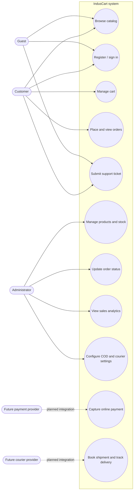
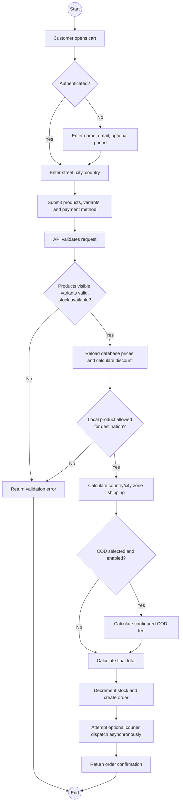
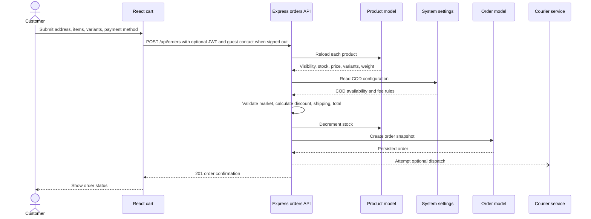
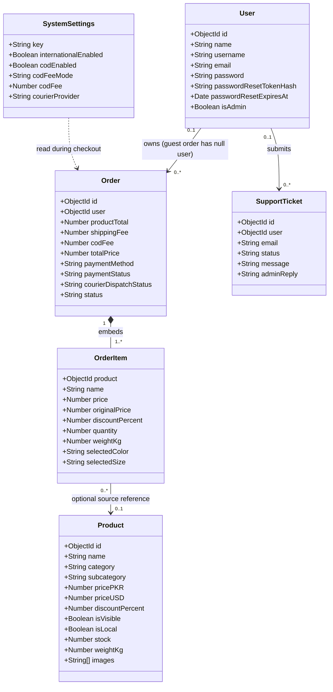
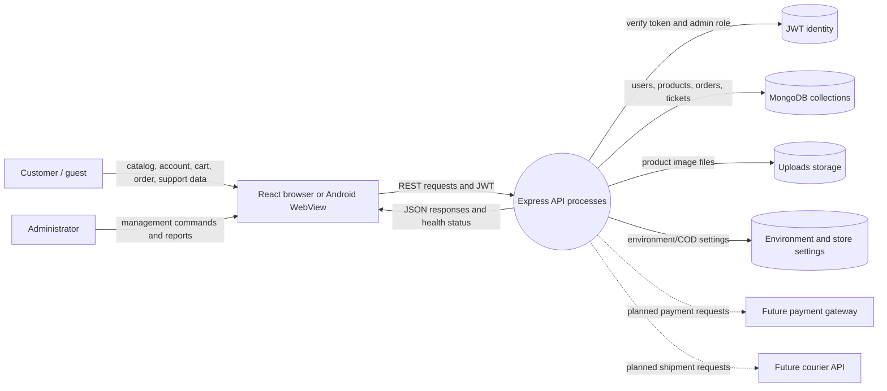
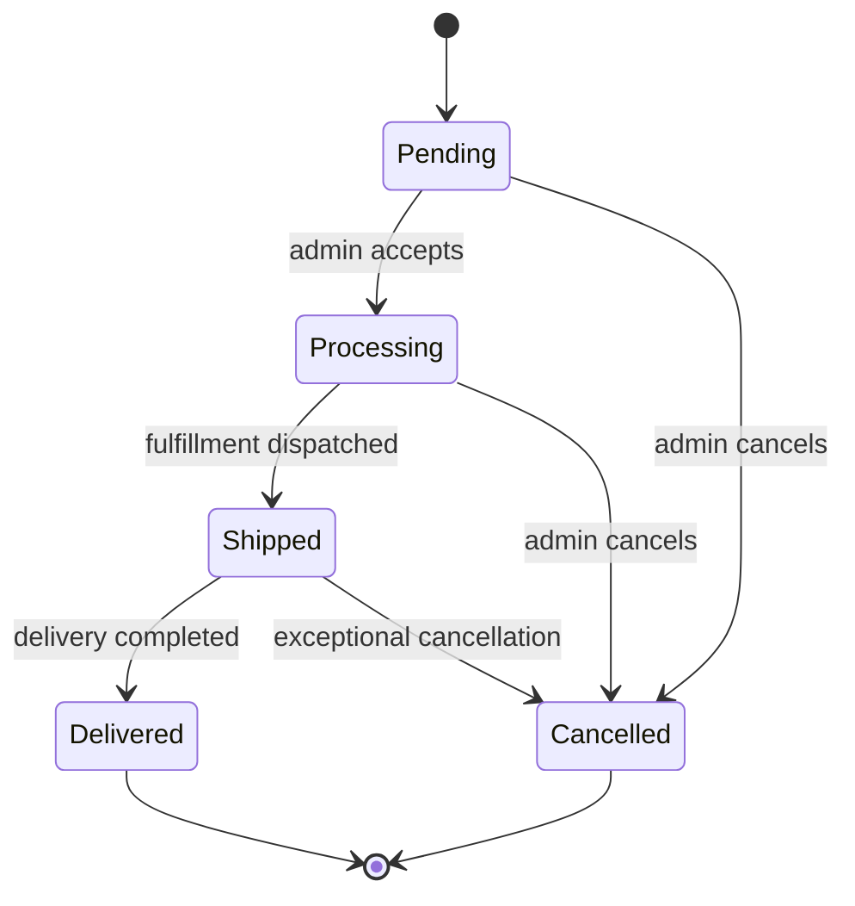

# IndusCart Software Requirements Document

**Version:** 1.0  
**Audit basis:** Repository implementation reviewed October 2026
**Status:** Functional MVP / pre-production

## 1. Purpose

IndusCart is a Pakistan-focused e-commerce platform with an international
selling mode. It provides a customer storefront, account authentication,
variant-aware cart and checkout, order status tracking, support tickets, and a
protected administrator workspace.

This document defines the current scope, requirements, acceptance criteria,
constraints, and release gaps. A requirement marked **Implemented** is present
in the repository. **Partial** means the user interface or data model exists
but the complete external integration or operational behavior is missing.
**Planned** means it should not be presented as available functionality.

## 2. Goals and stakeholders

### Goals

1. Let customers discover visible products and place validated orders.
2. Support Pakistan/PKR and international/USD catalog presentation.
3. Give administrators control over catalog, inventory, orders, settings, and
   operational analytics.
4. Keep the same React application usable in browsers, Docker, and Android.
5. Protect prices, stock, authentication, and administrator operations on the
   server.

### Stakeholders

| Stakeholder | Primary needs |
|---|---|
| Customer | Discover products, select variants, order, track status, get support |
| Administrator | Manage products, stock, orders, settings, analytics, tickets |
| Fulfillment operator | Process order statuses, COD, shipping, and future courier dispatch |
| Business owner | Control market availability, pricing, policies, and integrations |
| Developer/maintainer | Run, test, document, deploy, back up, and recover the system |

## 3. Scope

### In scope

- Responsive React/Vite storefront and admin UI
- User registration, login, JWT session verification, and admin authorization
- Product catalog, categories, dynamic subcategories, images, variants, stock,
  visibility, discounts, and local/global market rules
- Server-side product search, price filters, sorting, and pagination
- Persistent guest cart and account-synced customer cart with product/color/size identity
- Guest COD checkout with contact details and authenticated account checkout
- Customer self-service, email-based password reset with a single-use expiring token
- Admin-managed promo coupons with server-side eligibility and usage verification
- Verified-purchase product reviews with administrator moderation
- Customer wishlist and printable invoices/packing slips
- Low-stock customer badges and administrator alerts
- Server-side order validation, zone shipping, COD fees, stock decrement, and
  order status lifecycle
- Customer and guest support tickets with admin replies/status updates
- Sales analytics and manual cash-sale recording
- MongoDB persistence, local uploads, Docker Compose, health checks, backups,
  Capacitor Android packaging, and GitHub validation/APK workflows

### Out of scope for the current release

- Real payment capture, webhooks, refunds, and payment reconciliation
- Real courier booking, labels, tracking, and delivery webhooks
- Automated returns/refunds workflow
- Email/SMS/push notifications beyond account recovery
- Public production hosting, object storage, monitoring, and legal sign-off
- Multi-vendor settlement and automated returns/refunds workflow

## 4. SRS visual models

These diagrams are intentionally based on the implemented repository. They use
GitHub-compatible Mermaid and should be updated when requirements or routes
change. UML guidance separates structural views such as class/component models
from behavioral views such as use case, activity, sequence, and state models;
the data-flow view below documents movement between actors, processes, and
stores.

### 4.1 Use-case view

`Capture` and `Dispatch` are deliberately shown as future integrations, not
as completed capabilities.

### 4.2 Checkout activity diagram

### 4.3 Checkout sequence diagram

### 4.4 Domain class model

   `User.password` is the field name stored by the model and contains a bcrypt
   hash. `OrderItem` is embedded in an Order; manual cash items can have a null
   Product reference, and guest support tickets have a null User reference.
   `SystemSettings` is read while calculating an order but is not stored as a
   direct Order relationship.

### 4.5 Level-1 data-flow diagram

### 4.6 Order state diagram

This diagram describes the intended fulfillment journey. The current admin/API
still permits any enumerated status value; it does not enforce this graph.

### 4.7 Diagram coverage and missing views

| View | Status | Notes |
|---|---|---|
| Use case | Added | Actors and implemented/planned interactions |
| Activity | Added | Checkout validation and order creation |
| Sequence | Added | Browser-to-API checkout collaboration |
| Class/domain | Added | Mongoose domain model relationships |
| Object/instance snapshot | Added | Illustrative user/order/ticket/browser-state instance view in `UML_DIAGRAMS.md` |
| Package | Added | Mermaid package-group view of frontend/backend responsibilities |
| ER/data model | Added | See `ARCHITECTURE.md` |
| Data flow | Added | Level-1 actors, processes, stores, integrations |
| State machine | Added | Order lifecycle |
| Component/deployment | Added | `ARCHITECTURE.md` and `UML_DIAGRAMS.md` |
| Communication/collaboration | Added | Numbered message view in `UML_DIAGRAMS.md` |
| Interaction overview | Added | High-level shopper/admin flow in `UML_DIAGRAMS.md` |
| Timing view | Partial | Async courier ordering only; no SLA/latency guarantees are modeled |
| Composite structure | Not separately modeled | Current component/package views cover required structure; no plug-in ports exist |
| UML profile | Not applicable | No project-specific UML metamodel/stereotypes are defined |
| Payment/courier detailed flows | Missing | Add after real providers and webhooks are selected |
| Returns/refunds activity | Missing | Add when the returns domain model and workflow are implemented |

The standalone implementation-based UML set is maintained in
[`UML_DIAGRAMS.md`](./UML_DIAGRAMS.md); this SRD section retains the
requirements-level behavioral models.

## 5. Functional requirements

| ID | Requirement | Status | Acceptance summary |
|---|---|---|---|
| FR-01 | Register with account details | Implemented | Valid name/email/password creates a user and returns JWT |
| FR-02 | Role-separated shopper and administrator sign-in | Implemented | Shopper `/api/auth/login` refuses admins; `/api/auth/admin/login` refuses non-admins, checks role server-side, and limits failed attempts |
| FR-03 | Verify authenticated session | Implemented | Protected session endpoint returns current user |
| FR-04 | Restrict admin operations | Implemented | Admin UI route, dedicated login API, and protected admin APIs independently require an administrator identity |
| FR-05 | Browse visible catalog | Implemented | Public routes exclude hidden products |
| FR-06 | Search/filter/sort catalog | Implemented | UI supports text, category, market, and sort controls |
| FR-07 | Manage product details and variants | Implemented | Admin can set prices, images, category, brand, model, colors, sizes, stock, weight |
| FR-08 | Apply scheduled discounts | Implemented | Discount percentage and inclusive start/end dates are validated server-side |
| FR-09 | Maintain a variant-aware cart | Implemented | Product plus selected color/size identifies a cart line |
| FR-10 | Validate and create orders | Implemented | Server rechecks product, stock, visibility, price, variants, address, and payment method |
| FR-11 | Calculate zone shipping and COD fees | Implemented | Server calculates weight/zone shipping and configured COD fees |
| FR-12 | Track order lifecycle | Implemented | Pending, Processing, Shipped, Delivered, Cancelled are persisted and displayed |
| FR-13 | Capture online payment | Partial | Payment methods exist, but no provider capture/webhook/refund exists |
| FR-14 | Dispatch to courier | Partial | Settings and service seam exist; provider adapter is not implemented |
| FR-15 | Customer order history | Implemented | Authenticated user can list and view authorized orders |
| FR-16 | Support tickets | Implemented | Guest/user creation, user list, admin list, reply, and status endpoints exist |
| FR-17 | Admin sales analytics | Implemented | Revenue, channel, period, product, hour, day, and region aggregates exist |
| FR-18 | Manual cash-sale recording | Implemented | Admin can record a cash sale without a catalog product |
| FR-19 | Store settings | Implemented | Admin can enable/disable international shopping and configure COD/courier settings; public API exposes checkout-safe availability fields |
| FR-20 | Public health checks | Implemented | Live and readiness endpoints report process/database state |
| FR-21 | Android package | Implemented | Capacitor packages the web build; public HTTPS API is required outside local Wi-Fi |
| FR-22 | Automated build validation | Implemented | GitHub Actions validates backend syntax/tests and frontend tests/build |
| FR-23 | Automated APK artifact | Implemented | Tag/manual workflow builds debug APK when `VITE_API_URL` is a public HTTPS URL |
| FR-24 | Returns/refunds workflow | Planned | Requires model, API, UI, eligibility, approval, refund, and stock rules |
| FR-25 | Notifications | Planned | Requires email/SMS/push provider, templates, retry, and preferences |
| FR-26 | Guest COD checkout | Implemented | Guest submits contact/address details; order creation is rate-limited and cannot be read through a public order lookup |
| FR-27 | Public password reset request | Implemented | Public request is rate-limited, uses a generic response to reduce account enumeration, and emails an eligible customer a single-use 20-minute link |
| FR-28 | Navbar live product search | Implemented | Debounced suggestions link to products and full shop results |
| FR-29 | Admin order/product CSV export | Implemented | Admin can download full loaded datasets with spreadsheet-formula-safe CSV values |
| FR-30 | Promotion countdown/scarcity badges | Partial | Dated discounts show countdowns; stock badges indicate 1–4 remaining; no stock reservation timer exists |
| FR-31 | Maintain guest and account carts | Implemented | Guest cart persists in browser storage; signed-in cart is account-scoped in MongoDB and synchronizes with the browser |
| FR-32 | Apply promotion coupons | Implemented | Server checks active state, currency, minimum, expiry, and usage limits; order creation revalidates and claims usage |
| FR-33 | Submit and moderate product reviews | Implemented | Only a customer with a delivered order can review a product; one review per product; admin approval is required before public display |
| FR-34 | Maintain a wishlist | Implemented | Signed-in customers can add/remove products and move a saved product to cart |
| FR-35 | Change or reset a password | Implemented | Authenticated users can change their password; public customer recovery uses a hashed, single-use token expiring after 20 minutes |
| FR-36 | Admin-initiated customer password reset | Implemented | Admin can request an email reset for a non-admin customer; a verified email provider is required |
| FR-37 | Print invoices and packing slips | Implemented | Authorized customer or admin can open an order document and use browser print / Save as PDF |
| FR-38 | Manage shipment references | Implemented (manual) | Admin can save courier, tracking reference, and safe HTTPS URL; no carrier booking or event synchronization is performed |
| FR-39 | Upload product images safely | Implemented | Admin-only JPG/JPEG/PNG/WEBP uploads; maximum five images per request and 5 MiB per image; content signature is checked |
| FR-40 | Page public catalog results | Implemented | Filtered/search results default to 24 and are capped at 48 items per page |
| FR-41 | Export admin catalog and order data | Implemented | CSV export quotes cell values and neutralizes formula-like values before opening in spreadsheet software |

### 5.1 Detailed use-case specifications

These scenarios describe behavior present in the application. They complement
the use-case diagram in section 4.1; they are not claims that every step is
covered by an automated end-to-end test. See [`TESTING_GUIDE.md`](./TESTING_GUIDE.md)
for automated cases and the manual regression checklist.

#### UC-01 — Discover and inspect a product

- **Primary actor:** Guest or customer.
- **Preconditions:** The storefront and API are available.
- **Main flow:** Open the storefront; search or filter the visible catalog;
  choose a result; view product description, images, market price, stock, and
  available variants.
- **Alternatives / errors:** Hidden products are omitted from public catalog
  results. Invalid filters return a client-visible error; an unknown product
  displays the not-found state.
- **Postconditions:** No order or stock change occurs. Recently viewed entries
  are browser-local and are drawn from currently public catalog data.
- **Acceptance:** Search, category/subcategory, price bounds, sorting, market,
  and pagination affect the returned results; the API never relies on the
  browser to authorize hidden-product access.

#### UC-02 — Register, sign in, and maintain a session

- **Primary actor:** Shopper or administrator.
- **Preconditions:** The account exists for sign-in; registration details are
  valid for account creation.
- **Main flow:** A shopper registers or signs in on the shopper route; an
  administrator signs in through the separate admin route; the app verifies
  the JWT-backed session and loads the role-appropriate pages.
- **Alternatives / errors:** Invalid credentials are rejected; shopper login
  does not grant admin access, and admin login rejects shopper accounts.
  Expired sessions are cleared and protected navigation returns to the
  appropriate sign-in route.
- **Postconditions:** A successful user has a session; role authorization is
  independently enforced by API middleware.
- **Acceptance:** A password is at least eight characters; general auth is
  limited to 30 requests per IP per 15 minutes; failed admin login is limited
  to five attempts per IP per 15 minutes.

#### UC-03 — Place a guest COD order

- **Primary actor:** Guest.
- **Preconditions:** Cart contains at least one eligible, in-stock product;
  COD is enabled for the order.
- **Main flow:** Review cart and selected variants; provide guest name, email,
  address, and optional phone; submit the order; API reloads current product
  and settings data, validates the order, calculates prices/discounts/shipping
  and COD fee, decrements stock, and persists the order.
- **Alternatives / errors:** Reject invalid contact/address data, unavailable
  or hidden products, invalid variants, insufficient stock, restricted market,
  invalid coupon, or disabled COD. Guest order creation is rate-limited.
- **Postconditions:** A persisted order is shown to the guest at confirmation.
  There is no public guest order-history lookup; guest order access remains
  restricted to administrator workflows.
- **Acceptance:** The saved total is derived on the server, not from submitted
  browser prices. The payment state reflects COD/payment-pending behavior and
  does not claim an online payment was captured.

#### UC-04 — Place an authenticated customer order

- **Primary actor:** Signed-in customer.
- **Preconditions:** A valid session and an eligible cart are available.
- **Main flow:** Review items and variants, enter a delivery address, optionally
  apply a coupon, select an available payment method, submit, then review the
  order confirmation and order history.
- **Alternatives / errors:** The API rejects stale price, invalid coupon,
  hidden/local-market-ineligible product, variant mismatch, or insufficient
  stock. Online provider names are not offered as working checkout options
  without an implemented payment adapter.
- **Postconditions:** The customer can view only their own order and authorized
  invoice/tracking details.
- **Acceptance:** Repeated coupon checks do not bypass the order-time
  eligibility/usage verification; order item prices and totals are
  server-calculated snapshots.

#### UC-05 — Maintain a cart, wishlist, and review

- **Primary actor:** Guest or signed-in customer.
- **Preconditions:** A public product is available.
- **Main flow:** Add a product and selected color/size to cart; change quantity
  or remove the matching variant line. A signed-in customer can add/remove a
  wishlist item, move it to cart, and submit a review after delivery.
- **Alternatives / errors:** Cart quantity cannot exceed available stock.
  Wishlist and review actions require sign-in. A review without a delivered
  purchase or a second review for the same product is rejected.
- **Postconditions:** Guest cart state persists locally; signed-in cart and
  wishlist persist for that account; a submitted review remains hidden until
  approved by an administrator.
- **Acceptance:** Signing in hydrates/synchronizes the account cart without
  mixing another account's local cache.

#### UC-06 — Request account recovery

- **Primary actor:** Customer; email provider is a supporting system.
- **Preconditions:** Customer has an eligible account and the service has
  Resend credentials and a verified sender configured.
- **Main flow:** Submit the public recovery form; receive the same generic
  confirmation regardless of whether an eligible account exists; open the
  emailed reset link and choose a valid password.
- **Alternatives / errors:** Invalid, expired, or already-used tokens are
  rejected. Request endpoint allows five requests per IP per 15 minutes.
- **Postconditions:** A successful reset consumes the hashed token; the link
  expires after 20 minutes. Recovery email is not sent when the mail service
  is not configured.

#### UC-07 — Submit and resolve a support ticket

- **Primary actor:** Guest/customer and administrator.
- **Preconditions:** Support route and API are available.
- **Main flow:** Guest submits contact details or a signed-in customer submits
  a ticket; the customer can list their own tickets; an administrator lists
  tickets, replies, and updates status.
- **Alternatives / errors:** Invalid ticket input is rejected; a customer
  cannot list another user's tickets; an administrator-only action rejects a
  non-admin session.
- **Postconditions:** Ticket and replies/status are persisted in MongoDB.
  Customer notification email is not sent by the current implementation.

#### UC-08 — Administer catalog, inventory, and promotions

- **Primary actor:** Administrator.
- **Preconditions:** Valid administrator session.
- **Main flow:** Create/edit/hide/delete a product; set price, market,
  categories, variants, stock, discount window, and images; manage coupons and
  moderate reviews; inspect low-stock alerts and export currently loaded data.
- **Alternatives / errors:** Non-admin requests are denied. Uploads reject
  disallowed extension/MIME/signature, more than five images, or an image over
  5 MiB. Product names/descriptions/categories and coupon constraints are
  validated.
- **Postconditions:** Changes persist and the public catalog reflects
  visibility/availability; order-time validation uses current database values.

#### UC-09 — Fulfill an order and record a cash sale

- **Primary actor:** Administrator.
- **Preconditions:** Valid administrator session and an existing order for
  fulfillment, or a cash sale to record.
- **Main flow:** Review order, update it to a valid status, add manual courier
  and secure tracking details, inspect analytics, or record a manual cash sale.
- **Alternatives / errors:** Invalid status, tracking URL, amount, item, or
  quantity is rejected. Courier dispatch is best-effort and does not make
  carrier booking available; the API does not enforce a strict status
  transition graph.
- **Postconditions:** Order, manual shipment metadata, analytics source data,
  or cash-sale record is persisted. Inventory is restored only when an order
  is cancelled before shipment.

#### UC-10 — Operate and recover the service

- **Primary actor:** Developer/operator.
- **Preconditions:** Required runtime configuration is supplied.
- **Main flow:** Start the API and frontend locally or with Docker; use
  liveness/readiness and Prometheus metrics; back up or restore MongoDB; build
  the Android package and run CI validation.
- **Alternatives / errors:** Startup fails explicitly when required
  `MONGO_URI` or `JWT_SECRET` is missing, or when a staging/production secret
  is shorter than 32 characters or a known placeholder.
- **Postconditions:** Runtime/build status is observable; Docker data survives
  container replacement through named volumes. Backup scheduling, off-host
  retention, and recovery objectives remain deployment responsibilities.

## 6. Core business rules

1. Hidden products remain in the admin catalog but are excluded from public
   product responses.
2. Pakistan-only products cannot be ordered for a non-Pakistan country.
3. Pakistan orders use PKR product prices; other countries use USD product
   prices. Shipping uses server-side zone rates.
4. Discounts are active only within their optional inclusive date range.
5. The API calculates order prices from the database and does not trust browser
   prices.
6. Public catalog requests cannot reveal hidden products; hidden catalog data is
   available only to authenticated administrators.
7. COD can be disabled and can use a flat or percentage fee with an optional
   product-total threshold.
8. Cancelling an order restores stock only when its previous status is Pending
   or Processing. Cancellation after Shipped remains possible but does not
   restore stock. Concurrent order creation still needs a transaction or
   compensation design before high-volume production.
9. A courier failure must not fail order creation; the current service reports
   `not_configured` or `provider_not_supported`.
10. Payment method selection is not payment settlement. Non-COD methods must not
   be described as captured payments until a provider is integrated.

## 7. Non-functional requirements

The current behavior column is code-verifiable. Production targets marked
**Not established** need a business/operations decision and measurement; they
must not be represented as existing service-level guarantees.

| ID | Quality attribute | Current, verifiable constraint or control | Production target / acceptance evidence |
|---|---|---|---|
| NFR-SEC-01 | Secret management | `MONGO_URI` and `JWT_SECRET` are required; staging/production reject JWT secrets shorter than 32 characters and known placeholders. | Store secrets in a managed secret store, rotate them, and document recovery; **not established**. |
| NFR-SEC-02 | Transport and browser security | Helmet headers are enabled; CORS can allow-list configured origins; JSON body is limited to 1 MiB. | Public storefront/API must use HTTPS; verify deployed headers and CORS with an environment-specific test. |
| NFR-SEC-03 | Authentication abuse control | General auth: 30 requests/IP/15 min; failed admin login: 5/IP/15 min; password-reset request: 5/IP/15 min. | Use a shared limiter store and explicitly configured trusted proxies when scaling; current limit storage is process-local. |
| NFR-SEC-04 | Password recovery | Reset token is stored hashed, single-use, and expires in 20 minutes; public confirmation is generic. | Verify delivery and abuse monitoring with the configured email provider; email delivery is not guaranteed by code alone. |
| NFR-SEC-05 | Upload safety | Admin-only JPG/JPEG/PNG/WEBP uploads; extension/MIME and file signature validation; at most five images, each at most 5 MiB; retained/deleted file paths are checked. | Use isolated object storage, malware/image processing, retention controls, and multi-instance tests before production scale. |
| NFR-DATA-01 | Data integrity | Server recalculates checkout totals; validates stock/variants; limits catalog pages to 48; coupon eligibility/usage is checked at order time. | Add transaction/compensation and concurrent last-item checkout tests before high-volume use. |
| NFR-DATA-02 | Persistence and recovery | MongoDB persistence, Docker named volumes, backup/restore scripts. | Define RPO/RTO, encrypted off-host backup schedule, retention, and timed restore-drill evidence; values are **not established**. |
| NFR-AVL-01 | Health/readiness | `/health/live` checks process response; `/health/ready` returns 503 while MongoDB is disconnected; Docker health checks are configured. | Set availability objective, external monitoring, alert route, and incident process; no uptime SLA is implemented. |
| NFR-PERF-01 | Catalog performance | Server-side search/filter/sort; 24-item default and 48-item maximum for filtered/paginated queries. | Establish latency/load thresholds with representative dataset and target hardware; no response-time SLA is measured. |
| NFR-PERF-02 | Media performance | Product images served from local backend disk/static route. | Use optimized image pipeline/CDN/object storage for public multi-instance traffic; none is configured. |
| NFR-USE-01 | Responsive usability | Responsive browser UI; a 360 px storefront viewport has been manually checked as noted in feature coverage. | Test all key flows at agreed viewport/browser matrix; no comprehensive cross-device certification exists. |
| NFR-A11Y-01 | Accessibility | Labels, semantic controls, and accessible UI checks exist in selected component tests. | Keyboard, screen-reader, contrast, and automated audits across all customer/admin flows; no global WCAG conformance claim. |
| NFR-MOB-01 | Android portability | Capacitor Android build targets the web frontend. | Signed release, reachable HTTPS API, supported-device matrix, and offline/error behavior must be verified before distribution. |
| NFR-OBS-01 | Observability | Prometheus HTTP/order metrics, health routes, and server error logging are implemented. | Add dashboards/alerts and sensitive-data filtering; no configured production monitoring/SLO alerting. |
| NFR-MNT-01 | Maintainability/testability | Backend uses Node's test runner; frontend uses Vitest; CI runs backend checks/tests and frontend tests/build. | Keep requirements-to-test links current and require passing CI/review for release; no test coverage percentage gate is configured. |

## 8. Environments

| Environment | Frontend API URL | Data | Purpose |
|---|---|---|---|
| Local | `http://localhost:5000` | Local MongoDB | Development |
| LAN test | `http://YOUR_COMPUTER_IP:5000` | Local MongoDB | Same Wi-Fi phone testing |
| CI | Repository variable for APK; no production secrets in normal CI | Ephemeral | Validation/build artifacts |
| Production | Public `https://api.example.com` placeholder | Managed MongoDB | Real customers after release sign-off |

## 9. Release gates

The release must not be called production-ready until:

- Public HTTPS API and database are deployed and tested.
- At least one real payment provider has capture, webhook, idempotency, and
  refund tests.
- Courier behavior is either implemented or removed from customer promises.
- Upload storage, backups, monitoring, rate limits, and recovery are ready.
- Legal documents contain real business identity and have been reviewed.
- Android release is signed, tested on real devices, and built with public API.
- CI checks and required human review pass for the `main` branch.

## 10. Traceability and evidence

- API entry point: `backend/server.js`
- Routes: `backend/routes/`
- Controllers: `backend/controllers/`
- Models: `backend/models/`
- Authentication: `backend/middleware/authMiddleware.js`
- Frontend routes: `frontend/src/App.jsx`
- Admin API operations: `frontend/src/pages/admin/adminApi.js`
- Local tests: `backend/test/`, `frontend/src/tests/`
- CI: `.github/workflows/ci.yml`
- Android build: `.github/workflows/android-apk.yml`
